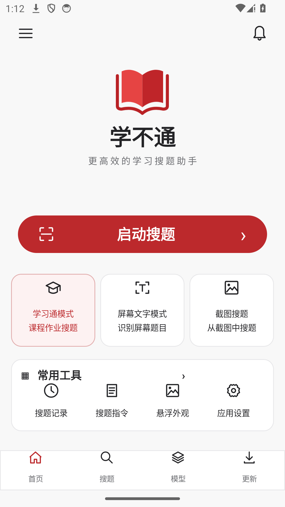
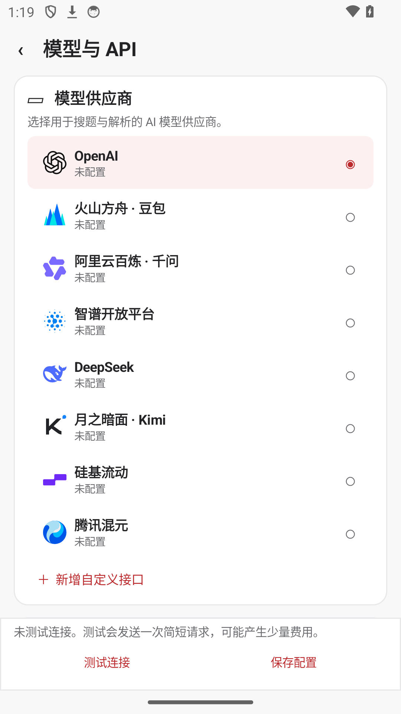

# 学不通

**完全免费，仅供非商业用途。** 项目公开源码，禁止商业用途；适用范围和教育、公益机构等例外以 [PolyForm Noncommercial License 1.0.0](LICENSE) 原文为准。第三方组件及素材遵循各自的授权条款。

学不通是一款 Android 学习辅助工具，支持无障碍读取页面文字、整屏本地文字识别及截图搜题。可配置自己的 AI 供应商和模型。

- [项目介绍页](https://1xuda.github.io/xuebutong/)
- [前往介绍页下载 6.1.5](https://1xuda.github.io/xuebutong/#download)
- 遇到 bug 请联系作者企鹅：**2899145437**，或通过本仓库 Issues 反馈。

## 界面预览

以下截图来自 6.1.5 版本的实际界面。

| 首页 | 模型与 API | 软件更新 |
| :---: | :---: | :---: |
|  |  |  |

## 使用须知

软件本身免费。AI 模型请求需要联网，第三方模型服务商可能收取费用，费用及模型权限以供应商为准。屏幕文字模式在本机识字；截图搜题会向所选视觉模型供应商发送整屏截图。API Key 和历史记录保存在本机应用数据中，请勿在 Issues、截图或提交内容中公开密钥。悬浮窗、无障碍和屏幕共享权限按所选功能在设备上授权。

应用内更新目前仍使用 `https://xudaco.online/xuebutong-site/releases/latest.json`，由原项目网站提供；GitHub Pages 是独立的介绍和下载入口。下载的新 APK 安装需用户确认，并要求与已安装版本签名匹配。

## 构建

需要 JDK 17、Android SDK Platform 34 和 Android Build Tools。首次构建需要网络下载 Gradle、Android Gradle Plugin 和 ONNX Runtime。

```powershell
.\gradlew.bat :android-app:assembleDebug
```

Debug 包位于 `android-app/build/outputs/apk/debug/`。项目不包含发布签名密钥；自行构建、使用不同签名的 APK 无法直接覆盖安装原签名版本。当前直接分发版本最低 Android 7.0（API 24），targetSdk 31。

## 页面与许可证

`docs/` 是 GitHub Pages 的静态介绍页面，使用 `main` 分支的 `/docs` 目录发布。项目代码按 [PolyForm Noncommercial 1.0.0](LICENSE) 提供源码，禁止商业用途；该许可证不属于 OSI 定义的开源许可证。

项目所含第三方组件、OCR 模型及供应商图标不因项目许可证而改变各自授权，见 [第三方说明](THIRD_PARTY.md) 和 `third-party-licenses/`。原启动页素材由项目维护者确认有公开及再发布授权。
